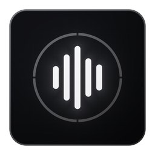
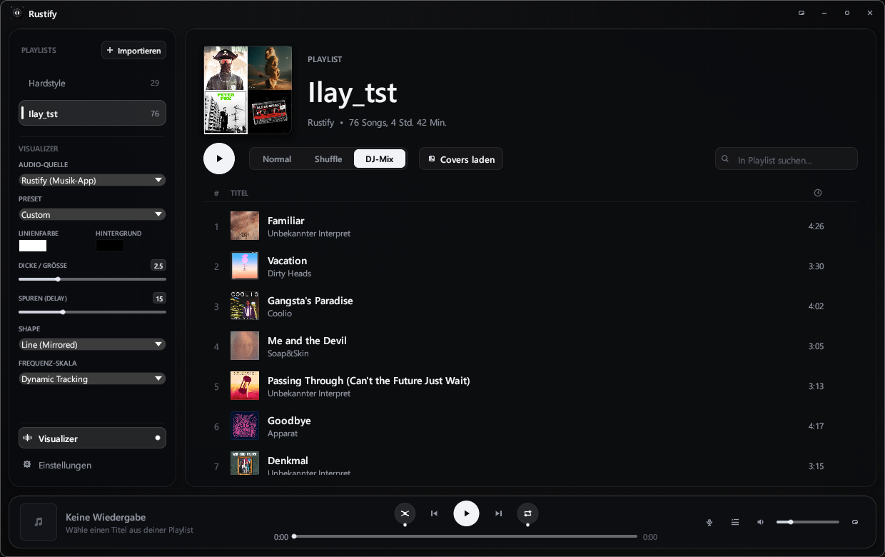
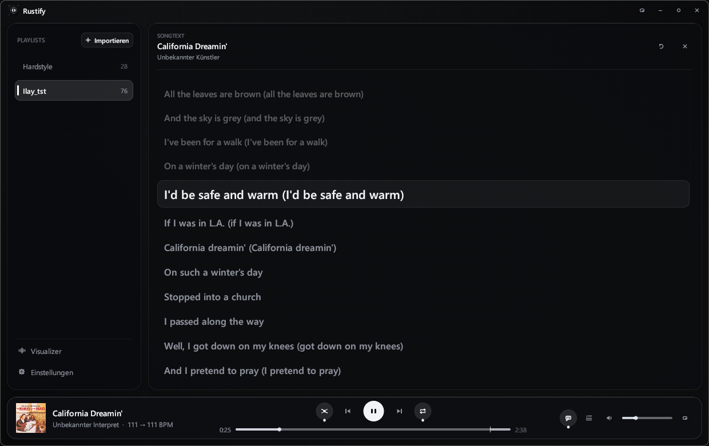
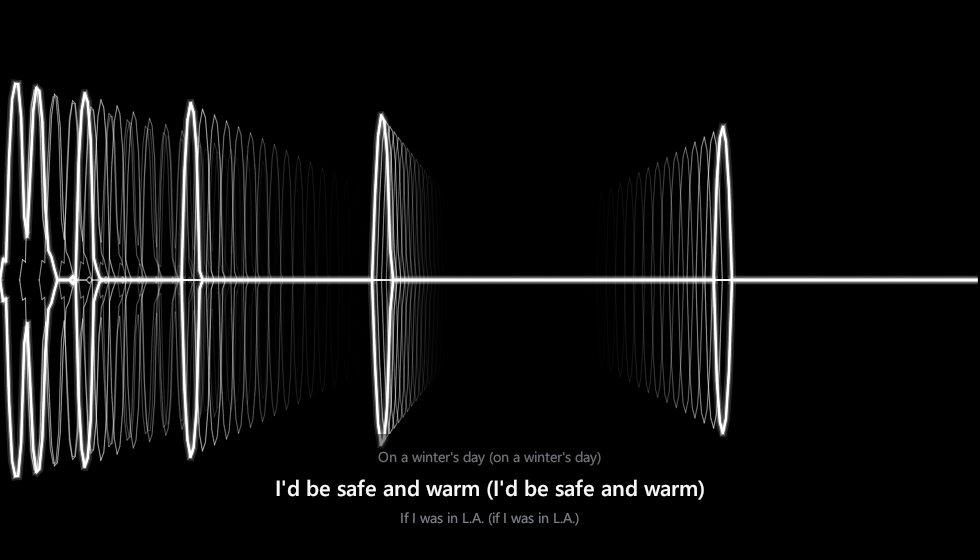
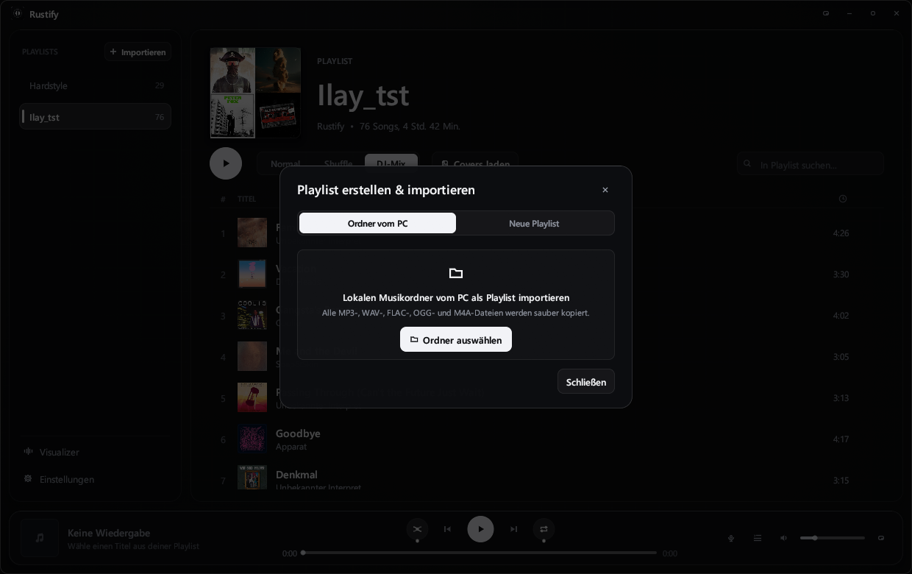

<div align="center">
  
  <h1>Rustify</h1>
  <p><strong>Minimalist Dark Liquid-Glass Local Music Player & AI DJ Automixer — Written 100% in Pure Rust</strong></p>

  <p>
    <a href="https://github.com/Ilay-dev/Rustify/releases/latest">
      
    </a>
    <a href="https://github.com/Ilay-dev/Rustify/releases/latest">
      
    </a>
    
    
  </p>
</div>

---

## Overview

**Rustify** is a fast, distraction-free desktop music player for your local music library built from the ground up in pure Rust (`eframe` / `egui` + `cpal` + `symphonia` + `beat-this`). It combines an ultra-clean monochrome **Liquid Glass** interface with club-grade **AI beat-matched DJ transitions**, a **real-time 5-band Equalizer**, **synchronized Karaoke Lyrics**, and a built-in **real-time Audio Visualizer** window.

<p align="center">
  
</p>

---

## Key Features

### Minimalist Monochrome Liquid Glass UI
- **Clean Spotify-inspired layout** in deep obsidian, graphite, and silver glass surfaces.
- **Automatic `Title - Artist` parsing** with full Unicode NFC support: displays the song title prominently with the artist underneath.
- **Playlist Hero Banner** with automatic 2x2 cover mosaics, total track count, and combined playlist runtime.
- **Mini-Widget Mode**: shrink Rustify into a sleek always-on-top compact player (`380 × 92`) with playback controls and one-click expand.
- **Bilingual (Deutsch & English)** with an intuitive first-run setup wizard.

### AI DJ Automix Engine (`beat-this` + Camelot Wheel)
- **3 Playback Modes**: `Normal`, `Shuffle`, and `DJ-Mix`.
- **AI Beat & Downbeat Tracking**: powered by the pure-Rust `beat-this` neural network (`rten` ONNX runtime — zero Python or external dependencies) to detect exact BPM, beat grids, and bar downbeats (*Takt 1*).
- **Harmonic Key Detection (Camelot Wheel `1A–12B`)**: computes a 12-bin chromagram against Krumhansl-Kessler profiles to chain harmonically compatible tracks smoothly in `DJ-Mix` mode.
- **Beat-Grid Phase-Locked Transitions**: dual-deck mixer with continuous Beat-Grid Phase-Locked Loop (PLL), club-style 220 Hz Linkwitz-Riley Bass-Swap EQ crossover, constant-energy gain curves, and automatic silence/intro cueing.

### Real-Time 5-Band Equalizer & Loudness Normalization (-14 LUFS / ITU-R BS.1770)
- **Loudness Normalization (-14 LUFS / ITU-R BS.1770)**: measures integrated track loudness via a 2-stage K-weighting biquad cascade with dual-gated 400 ms blocks and smoothly applies peak-safe makeup gain per deck so every song and DJ transition stays at consistent volume without clipping (toggleable anytime in **Settings**).
- Live stereo RBJ Biquad equalizer right in **Settings**:
  - **60 Hz** (Sub-Bass), **230 Hz** (Bass), **910 Hz** (Mids), **3.6 kHz** (Presence), **14 kHz** (Treble) from `-12 dB` to `+12 dB`.
  - Built-in presets: *Flat*, *Bass Boost*, *Hardstyle*, *Vocals*, *Pop / Rock*, and *Custom*.

### Discord Rich Presence (Zero-Config)
- Native pure-Rust Discord IPC integration (`ActivityType::Listening`) works **out of the box** using the official built-in Rustify Application ID — displaying the current track title, artist, playlist, and a live progress bar right on your Discord profile.
- Automatically reconnects if Discord starts later, clears presence cleanly on pause/exit, and can be toggled or overridden with a custom Discord Application ID in **Settings**.

### Automatic GitHub Release Updates
- Automatically checks GitHub Releases in the background on startup and notifies you via a Liquid Glass update popup (which can be disabled anytime in **Settings**).
- Supports one-click in-app download with live progress and seamless installer launch, plus manual update checks directly from **Settings**.

### Synchronized Lyrics (LRCLIB)
- Click the **Lyrics** speech-bubble icon in the player bar to open the Liquid Glass karaoke lyrics view.
- Automatically fetches synchronized `.lrc` lyrics via `lrclib.net`, caches them locally, highlights & auto-scrolls the current line, and lets you **click any line to seek** directly to that moment.

<p align="center">
  
</p>

### Built-in AudioVisualizer Window
- Native pure-Rust port of [AudioVisualizer](https://ilay-dev.github.io/AudioVizuallizer/) in a dedicated secondary window (`F` or double-click for fullscreen, `Space` to pause).
- **3 Live Audio Sources**:
  - **Rustify (Music App)** — lossless internal mixer output
  - **System Audio (Desktop)** — Windows WASAPI loopback & Linux PipeWire / PulseAudio (`parec` / `pw-record`) monitor capture for all desktop audio
  - **Microphone** — live microphone / line-in capture
- Live customization directly in the left sidebar while open (*Classic*, *Neon Pulse*, *Ocean Waves*, *Custom* colors, thickness, trail delay, shape, and frequency scale).
- **Live 3-Line Synchronized Lyrics Overlay**: displays the previous, current, and upcoming lyric lines centered inside the AudioVisualizer window (previous & next lines smaller in soft gray, active line crisp & bright) with a toggle and **Top / Bottom** positioning directly in the sidebar.

<p align="center">
  
</p>

### Local Library, Covers & System Integration
- Supports **MP3, FLAC, WAV, OGG, M4A, and AAC**.
- **PC Folder Import & Drag-and-Drop**: import any local music folder via `+ Import` or drag & drop audio files straight into a playlist.
- **Cover Art Manager**: one-click online cover fetching (saved locally in `<MusicFolder>/Covers/`) plus custom cover image support (permanently copied into `Covers/`).
- **Queue & Repeat**: *Play Next*, *Add to Queue*, live Queue popover, and *Repeat Off / All / One*.
- **Native OS Media Controls**: Windows SMTC & Linux MPRIS2 (D-Bus) integration — responds natively to hardware media keys (Play/Pause, Next, Previous) and desktop media overlays.

<p align="center">
  
</p>

---

## Installation

### Windows
1. Download **`Rustify-Setup.exe`** from the [**Latest Release**](https://github.com/Ilay-dev/Rustify/releases/latest).
2. Run the installer, choose your install folder (defaults to `C:\Program Files\Rustify`), and finish setup.
3. Launch **`Rustify`** directly from Windows Search or your Start Menu and select your local music folder in the setup wizard.

### Linux — Ubuntu (22.04 / 24.04) & Linux Mint (21 / 22)
1. Download **`rustify_1.4.0_amd64.deb`** from the [**Latest Release**](https://github.com/Ilay-dev/Rustify/releases/latest).
2. Install via Software Center / GDebi, or in your terminal:
   ```bash
   sudo apt install ./rustify_1.4.0_amd64.deb
   ```
3. Launch **Rustify** from your application menu or run `rustify`.

### Linux — Arch Linux (Manjaro / EndeavourOS / CachyOS)
1. Download **`rustify-1.4.0-1-x86_64.pkg.tar.zst`** from the [**Latest Release**](https://github.com/Ilay-dev/Rustify/releases/latest).
2. Install with `pacman`:
   ```bash
   sudo pacman -U rustify-1.4.0-1-x86_64.pkg.tar.zst
   ```
   *(Optional: install `pipewire-pulse` or `pulseaudio` for Desktop System Audio capture in the AudioVisualizer.)*
3. Alternatively, build directly from source using the included [`linux/PKGBUILD`](linux/PKGBUILD):
   ```bash
   cd linux && makepkg -si
   ```

### Linux — Portable Tarball (Any x86_64 Distro)
1. Download **`rustify-1.4.0-linux-x86_64.tar.gz`** from the [**Latest Release**](https://github.com/Ilay-dev/Rustify/releases/latest).
2. Extract and install to `~/.local` (no `sudo` required):
   ```bash
   tar -xzf rustify-1.4.0-linux-x86_64.tar.gz
   cd rustify-1.4.0-linux-x86_64
   ./install.sh
   ```

### Folder Structure Tip
Rustify treats each subfolder inside your chosen Music Folder as a playlist:
```text
Music/
├── Electronic/
│   ├── Track One - Artist A.mp3
│   └── Track Two - Artist B.flac
├── Chill/
│   └── Sunset Drive - Artist C.mp3
└── Covers/                # Automatically managed by Rustify
```

---

## Keyboard Shortcuts

| Shortcut | Action |
| :--- | :--- |
| `Space` | Play / Pause |
| `←` / `→` | Seek 5 seconds backward / forward |
| `Ctrl + ←` / `Ctrl + →` | Previous / Next track |
| `↑` / `↓` | Volume up / down |
| `M` | Mute / Unmute |
| `Ctrl + F` | Focus playlist search |
| `Esc` | Close active modal / overlay |
| `F` *(in Visualizer)* | Toggle Visualizer fullscreen |

---

## Building from Source

Requires the [Rust toolchain](https://rustup.rs/) (Rust 1.85+):

### Linux Build Dependencies
- **Ubuntu / Linux Mint**:
  ```bash
  sudo apt install libasound2-dev libgtk-3-dev libxcb-render0-dev libxcb-shape0-dev \
    libxcb-xfixes0-dev libxkbcommon-dev libssl-dev libdbus-1-dev pkg-config
  ```
- **Arch Linux**:
  ```bash
  sudo pacman -S --needed base-devel rust alsa-lib gtk3 dbus libxkbcommon libglvnd curl
  ```

### Compile
```bash
git clone https://github.com/Ilay-dev/Rustify.git
cd Rustify
cargo build --release
```

The compiled executable will be located at `target/release/Rustify.exe` (Windows) or `target/release/Rustify` (Linux).

### Packaging
- **Windows Installer** ([Inno Setup 6](https://jrsoftware.org/isinfo.php)):
  ```powershell
  iscc installer\Rustify.iss
  ```
  Outputs `dist\Rustify-Setup.exe`.
- **Debian / Ubuntu / Mint `.deb`**:
  ```bash
  bash linux/build-deb.sh
  ```
- **Arch Linux `.pkg.tar.zst`**:
  ```bash
  bash linux/build-arch.sh
  ```
- **Portable Linux `.tar.gz`**:
  ```bash
  bash linux/build-tarball.sh
  ```

---

## License

Licensed under the [MIT License](LICENSE).
Built by [Ilay-dev](https://github.com/Ilay-dev).
